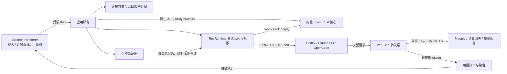

# Agent Room 架构

桌面默认使用内置 Rust N-API 核心，源码与验收详见 [NATIVE-INTEGRATION.md](NATIVE-INTEGRATION.md)。新增 Agent 使用 [无终端 RPC runtime](docs/RPC-MODE.md)，浏览器预览也复用此实现。

## 两条互不混用的链路

hcom 负责 Agent 间的协作消息，不代理模型推理。模型请求经过应用转发层；转发层不向群聊注入消息。两条链路各自失败、各自恢复，不把“hcom 已连接”等同于“模型可用”。

## 模块职责

| 模块 | 负责 | 不应负责 |
| --- | --- | --- |
| `main.cjs` / `preload.cjs` | 窗口、托盘、文件选择、IPC、生命周期 | 处理提示词、猜测引擎配置、回显凭证 |
| `lib/hcom-service.cjs` | 应用用例编排、原生 runtime 调用、工作区和群聊 | 协议转换、TLS 实现、统计解析细节 |
| `lib/rpc-runtime.cjs` / `lib/rpc/` | 会话队列、引擎控制、流式事件、权限与取消 | PTY、自动重放、上游凭证 |
| `lib/connection-profiles.cjs` | 方案校验、持久化、Key 加密、证书读取校验 | 启动 CLI、发送推理请求 |
| `lib/engine-connections.cjs` | 把连接方案转换成引擎自己的启动参数/配置 | 改写全局配置、持有上游 Key、决定路由 |
| `lib/model-gateway.cjs` | 会话级本地转发、调用者认证、上游认证、TLS、流式传输 | 修改消息内容、自动重试推理、聊天路由 |
| `lib/usage.cjs` | 三种协议的 usage 提取、追加记录、时间聚合 | 保存原始请求/响应、推测缺失用量 |
| `renderer/connections.js` | 方案编辑、模型列表、启动选择 | 直接访问文件、解密 Key |
| `renderer/usage.js` | 用量卡片、日历砖块图、模型分布和引擎表 | 生成虚假数据、把未知用量当零用量 |
| `renderer/app.js` | 工作区/会话/群聊交互 | 直接执行 CLI 或访问模型服务 |
| `renderer/design-tokens.css` / `renderer/workbench.css` | 浅深色设计变量、工作台布局和组件外观 | 模型配置、消息路由或持久化业务数据 |

应用服务通过依赖注入接收 hcom 执行器与 `safeStorage`，因此路由、适配器、持久化和 TLS 可以独立测试。引擎适配器接收的只有本地临时凭证，不能接收真实上游 Key。新增引擎时需显式声明协议能力，不能仅因为它接受 `--model` 就宣称支持自定义网关。

Renderer 依次加载基础 `styles.css`、`design-tokens.css` 和 `workbench.css`。基础样式保留连接、用量、头像等模块的结构，设计变量集中定义颜色、圆角与动效，工作台层负责布局及主题适配。轮询时只替换实际变化的动态 HTML，避免无变化的头部和详情更新打断键盘操作。

## 连接、协议和证书

一个连接方案包含 API Base URL、协议、认证方式、默认模型、模型参数和证书路径。启动时可覆盖模型，每次启动保留独立方案快照；后续编辑/删除方案不改变正在运行的会话。

- Responses：Codex、Pi、OpenCode。
- Chat Completions：Pi、OpenCode。
- Anthropic Messages：Claude Code、Pi、OpenCode。
- Magpie / 多协议：四种引擎；由**已有的上游网关**承担协议转换。Agent Room 不伪装成已实现 Magpie 的跨协议工具调用转换、订阅登录和账号故障转移。

转发服务器仅绑定 `127.0.0.1`，使用随机端口和独立随机凭证，拒绝带浏览器 Origin 的请求，并限制路由。上游 Key 在主进程中解密，仅发到明确配置的上游地址；不跟随重定向，避免把认证传到第二个地址。CLI / hcom 脚本中只出现临时本地凭证。

自定义 PEM CA 加入系统信任链，始终启用链验证和主机名验证。客户端证书/私钥只用于用户明确配置的 HTTPS 上游，口令也经系统加密。不会安装系统根证书或关闭 TLS 校验。

## 生命周期与故障

启动结果不明确时不自动再启动，也不销毁可能已被会话使用的转发器。存在托管会话或转发器时，关闭窗口隐藏到托盘。托盘的“退出并停止托管会话与模型转发”停止应用拥有的会话，再关闭转发并等待用量落盘。没有活跃会话或网关时关闭窗口正常退出；应用外已有会话不受影响。

自定义配置使用 CLI 参数、OpenCode inline config 或 Pi 的显式 Provider 扩展，不改写用户的全局模型配置。默认 RPC 路径不准备 PTY hooks；内置核心负责应用私有 hcom 总线。旧 NativeRuntime 的 PTY 代码只作为兼容实现保留。浏览器预览使用独立的私有目录。

## 用量计量规则

每个转发请求最多记一条记录，结束或中断时落盘。SSE 按字节分块解码，使用有界缓冲，累积 usage 取最终/最大字段值，防止重复 final event 或 Anthropic 累计 output 被重复相加。支持 Responses、Chat Completions 和 Anthropic 的 JSON/SSE usage。

OpenAI 输入中已含 cached tokens；Anthropic 的新输入、缓存读取和缓存创建分别返回，聚合时先组合成总输入。总 Token = 总输入 + 输出，缓存不额外重复加一次。缺失 usage 记为 `null`，统计为“用量未知”，而不是已知零。中断请求中观察到的用量可能只是下界。

`usage.jsonl` 只保存版本、随机 ID、时间、引擎、模型、方案 ID、HTTP 状态、中断标志和计数。优先使用响应报告的模型 ID。无提示词、回复、Key、证书内容。记录有序追加，发现损坏行时保留原文、跳过损坏行并在界面提示；后续写入不会吞并到损坏尾行。退出时等待待写入记录完成。

看板聚合当前系统时区的最近 364 天，展示 52 周砖块图、模型分布与引擎用量。CLI 原配置和未经过本应用转发的旧会话无法计量，不导入其他 CLI 历史作为累计账单，不推估费用。上下文观测单独按 hcom 绑定的 Codex 会话读取有限 Token 元数据，不保存对话内容。

## 当前边界与后续扩展点

这是单机预览版：应用编排和转发器运行在 Electron 主进程，hcom Rust 核心运行在 utility process，CLI 使用独立的管道进程或本地 HTTP 服务。网络 I/O 异步且流式缓冲有界。若以后增加大量并发或跨协议转换，应把转发器移到 utility process，保留当前启动/统计接口；不要把网络转发或凭证移到 Renderer。

工作区用于 UI 与接收者范围组织，各工作区共享应用私有 hcom 总线；不是权限隔离。用量账本当前启动时读入内存，适合本地预览；大规模历史应将 `UsageLedger` 替换为带迁移与查询索引的 SQLite 存储，不改变 Renderer。

## 参考

- [Magpie](https://github.com/yetone/magpie)：参考其 provider → gateway → agent 的产品组织；可作为已有上游接入。未复制其源码。
- [Codex configuration reference](https://developers.openai.com/codex/config-reference/)：`model_providers`、`env_key`、`wire_api` 与 provider 覆盖。
- [Claude Code third-party integrations](https://code.claude.com/docs/en/third-party-integrations)：自定义 gateway 入口。
- [Pi custom providers](https://github.com/badlogic/pi-mono/blob/main/packages/coding-agent/docs/custom-provider.md)：每会话注册 Provider。
- [OpenCode config](https://opencode.ai/docs/config/) 与 [providers](https://opencode.ai/docs/providers/)：inline config 与自定义 Provider。

## 统一能力库与上下文

详见 [统一 MCP / Skills 与上下文设计](docs/CAPABILITY-HUB.md)。MCP / Skills 能力库、会话 MCP Hub、Skills 快照按需读取和启动分配已实现；每 Agent 上下文观测也已实现，区别于累计用量，标注原生记录、网关估算、配置上限与未知状态。
