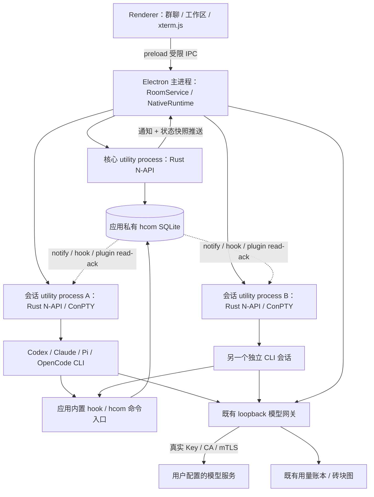

# hcom 原生融合：PTY 兼容实现与历史记录

当前默认新增 Agent 已切换到 [无终端 RPC 模式](docs/RPC-MODE.md)，不走下述 ConPTY 路径。本文保留原生核心与旧 PTY 实现的设计和历史验收材料。

历史状态：Windows 原生预览实现。2026-10-29 已验证原生模块加载、Electron utility process、ConPTY 双会话通信，以及真实 Pi 经本地模型模拟服务调用 bash/hcom、生成用量记录。真实付费上游、多引擎完整模型对话及安装包验收仍需分别验证。

## 决策

采用源码级融合：固定 hcom `v0.7.31` / `de33e31a0cdbba4c5863f7cc050d8b79aa50bcdf`，在 `native/hcom` 保留 MIT 源码与许可，构建 Rust N-API 模块 `agent_room_hcom.node`。Electron 主进程通过受限消息接口管理 utility process，Renderer 不加载原生模块。

用户只打开 Agent Room。桌面版不再查找全局 hcom，不再以 `hcom <tool> --go` 打开外部终端，也不再每 2.5 秒创建 CLI 进程查询列表。已有独立 hcom 会话不接管、不移动、不停止。

“原生融合”包含几个内部进程：Electron 本身采用多进程，CLI 也必须作为子进程运行。安装资源中仍有 `hcom.exe`，作为各 CLI 的短生命周期 hook / 命令兼容入口；它调用同一份 Rust 源码，不需要用户安装或单独启动，不承担常驻桌面后端。

## 数据流与进程边界



核心进程准备启动计划：校验引擎、生成名字和进程绑定、准备会话 hooks、合并模型参数。原先进入 shell 脚本和外部终端的分支被截获，改为返回 `tool / args / env / cwd / instance_name`。计划只在可信进程间传递，Renderer 只收到脱敏句柄。

主进程为每个会话创建一个 utility process，启动前固定 cwd 和环境，再加载原生模块。该进程只拥有一个 ConPTY，直接启动已解析的 CLI，向应用推送输出、接收输入和 resize，退出时释放 Windows Job Object 及该会话的进程树。

## 为什么首版每个会话一个 utility process

源码不具备可直接多会话共用的库 API。`Cargo.toml` 原来只有 bin；`Config` 持有进程级缓存，`delivery.rs` 的退出状态也是静态变量；Windows proxy 使用当前进程 cwd、stdin/stdout，并依赖 `process::exit` 清理阻塞输入线程。

因此首版通过进程边界隔离每个会话的身份与退出状态，避免在一个原生实例中运行多个 Agent 导致串线。这里使用 Electron 的 utility process 加载 `.node`，不另启一个 hcom 守护程序。进一步合并会话进程需要先把所有进程全局状态改成显式 `RuntimeContext / SessionContext`，不能只给 `Proxy` 加一个数组。

Windows native 构建用可取消的输入 channel 替换阻塞 stdin，通过输出 channel 接 N-API 回调；resize 由 xterm.js 容器尺寸驱动。原来的注入、屏幕跟踪、ready 检测和投递门控继续复用。

## 模块边界

| 模块 | 职责 |
| --- | --- |
| `lib/hcom-service.cjs` | 房间、Workspace、@解析、连接启动编排；注入原生 runtime 后调用类型化 API |
| `lib/native-runtime.cjs` | Electron utility process 创建、RPC 关联、会话句柄、终端回放与退出清理 |
| `lib/runtime-host.cjs` | 在 utility process 内加载 `.node`，映射固定方法；会话角色只接终端输入、resize、stop |
| `native/hcom/src/embedded.rs` | 原生快照、发送、启动计划、通知订阅、会话 I/O；不接收通用 shell 字符串 |
| `native/hcom/src/launcher.rs` | 复用 hcom 准备逻辑，在外部启动分支前返回内嵌计划 |
| `native/hcom/src/pty/win.rs` | ConPTY、原生通道、屏幕跟踪、投递、Windows 进程树生命周期 |
| `renderer/terminal.js` | 本地 xterm.js，按序号合并回放与实时输出；关闭面板只取消订阅 |
| 现有 Profiles / Gateway / Usage | 系统加密、模型连接转换、CA/mTLS、推理流转发和 Token 统计，独立于协作消息总线 |

桌面入口默认使用原生 runtime，构建缺失时显示错误，禁止静默降级到全局 hcom。浏览器预览 `server.cjs` 仍是显式保留的旧外部集成入口，不能作为原生桌面验收证据。

## 四种引擎的接入

| 引擎 | 复用的 hcom 机制 | 应用处理 |
| --- | --- | --- |
| Codex | 会话级 hooks、hooks/list 预检、bootstrap、PTY 唤醒 | 保留版本能力检查；支持桌面包 CLI 的进程级 PATH 优先级；终端显示首次交互 |
| Claude Code | 合并 `--settings`、per-run hooks / plugin、Stop 与 PTY 门控 | 保留交互 TUI；不自动改成 `-p`，不把登录或工作区信任提示藏掉 |
| Pi | 显式 `-e` hcom 扩展、`sendUserMessage`、通知、read/ack | hcom 扩展与现有自定义 Provider 扩展共同加载；保留 busy/idle 与 admitted 后 ack 的行为 |
| OpenCode | 会话插件、inline config 合并、插件 transport 与 admitted 后 ack | 合并已有网关模型配置中的 plugin 字段；保留版本差异，不用模拟键盘替代全部消息投递 |

共同使用 ConPTY 展示 CLI，实际消息接入仍按各引擎能力处理。完整推理正文不会因为显示在终端里就自动变成群聊消息；群聊仍来自明确的 hcom 消息事件。

## Workspace、Tag 与数据

本地开发桌面数据位于 `.data`，发布版使用 Electron `userData`。hcom 核心显式使用 `<dataDir>/runtime`，不会读取全局 `~/.hcom` 数据库；私有 hcom 目录不自动重定位各引擎自己的认证目录。

Workspace 仍按工作目录组织，房间成员及 `@tag` 在应用层解析成显式接收者。同一引擎可以有多个独立名字、cwd、模型连接和进程。当前各 Workspace 共用一个应用私有 hcom 数据库；Workspace 和 thread 不是操作系统安全边界，也不是对 Agent shell 的沙箱。

原生启动跳过上游的全局旧 hook 删除及持久权限文件改写，只生成本次会话的注入配置。已有旧版全局 hcom hook 与新会话注入的兼容性仍需按 CLI 版本检查；不以清理旧会话配置来解决冲突。

## 投递、失败与生命周期

- 写入消息和发出 notify 是不同阶段。notify 只用于唤醒，持久事件和引擎 ack 才是投递依据；UI 不把“数据库已接受”显示成“模型已完成回复”。
- native watcher 使用 hcom 的 `events_wait` 通知，并每秒在进程内对账，补偿状态单独更新或漏通知；无周期性 CLI spawn。快照仍取最近 500 条消息，完整历史分页尚未实现。
- IPC 请求具有关联 ID 和超时，不自动重发有副作用的消息或启动请求。当前没有端到端 exactly-once 保证，结果未知时保留核查路径。
- 终端回放每会话最多保存 2 MiB 原始字节，native 输入队列和输出队列有界，xterm scrollback 设为 3000 行。只向打开终端面板的 Renderer 推送输出，回放加载期间最多暂存 512 个事件。IPC 到 Renderer 尚未做完整的 credit 背压，大输出压力测试属于后续验收。
- 关闭终端面板保留会话。存在托管会话或网关时，关闭主窗口进入托盘；明确退出停止本应用会话并关闭网关，等待用量落盘。
- 会话退出关闭其模型网关。核心进程异常后拒绝未完成调用并停止本应用托管会话，避免盲目重建或重复执行任务。不会终止应用外部既有 Agent。
- 崩溃后不自动恢复现场或重放提示；历史和会话重建是不同操作。安装包、更新、签名以及崩溃恢复 UI 尚未交付。

## 构建与验收

需要 Windows x64、Rust 1.92.0 MSVC、Visual Studio C++ Build Tools / Windows SDK，以及 Node/npm。运行 `npm run build:native`；发布优化构建使用 `npm run build:native:release`。原生文件和 helper 在 `native/bin`，xterm 依赖复制到 `renderer/vendor`，均不依赖 CDN。

每组原生模块 / helper 按内容指纹存入独立目录，完整复制并校验后更新 `native/bin/runtime.json`。应用启动时选择构建，后续会话固定使用该版本；构建不会覆盖运行中的 DLL，也不会停止旧会话。新构建需重新打开应用生效；当前不自动删除旧构建目录，打包时应只收录 manifest 指向的构建及许可。

可重复验证：

```powershell
npm run check
npm test
node scripts/verify-native.cjs
node scripts/verify-native-pi.cjs
```

`verify-native.cjs` 使用两份离线 CLI fixture，真实加载 Rust 模块、ConPTY 和 hcom hook/helper，检查名字、cwd、输入隔离、定向投递、Agent 间发送和停止。也已通过 Electron 运行同一脚本验证真实 utility process；Electron 模式需要把本机 Node 路径放入 `AGENT_ROOM_TEST_NODE`，并清除该子进程的 `ELECTRON_RUN_AS_NODE`。

`verify-native-pi.cjs` 使用本机真实 Pi 和应用的 Provider 适配器，通过 loopback 模拟推理响应，让 Pi 实际执行 bash/hcom 回复，再检查认证替换和 usage 账本。测试用量写在临时目录，不进入用户统计。为避免首次下载影响测试，隔离的 Pi home 会复制本机 `~/.pi/agent/bin` 下已有的 rg/fd；也可通过 `AGENT_ROOM_PI_TOOLS` 指定现有工具目录，未找到时由 Pi 自行准备。它验证真实 Pi 接口与原生链路，不代表真实远程模型质量或账号可用。

证据：`artifacts/native-node-check.json`、`artifacts/native-electron-check.json`、`artifacts/native-real-pi-check.json`。没有用测试数据填充产品看板。

## 源码依据

以下均固定到本次核实的上游 commit：

- [Cargo 与 Windows 原生依赖](https://github.com/aannoo/hcom/blob/de33e31a0cdbba4c5863f7cc050d8b79aa50bcdf/Cargo.toml)：bin、Rust 版本要求、SQLite、portable-pty、ConPTY assets。
- [启动编排](https://github.com/aannoo/hcom/blob/de33e31a0cdbba4c5863f7cc050d8b79aa50bcdf/src/launcher.rs)：per-run 注入、进程绑定、终端和后台启动分支。
- [Windows Proxy](https://github.com/aannoo/hcom/blob/de33e31a0cdbba4c5863f7cc050d8b79aa50bcdf/src/pty/win.rs)：console I/O、Job Object、退出清理。
- [发送与唤醒](https://github.com/aannoo/hcom/blob/de33e31a0cdbba4c5863f7cc050d8b79aa50bcdf/src/commands/send.rs)：事件持久化与 notify；[通知接收](https://github.com/aannoo/hcom/blob/de33e31a0cdbba4c5863f7cc050d8b79aa50bcdf/src/notify/server.rs)只携带唤醒语义。
- [Pi 插件](https://github.com/aannoo/hcom/blob/de33e31a0cdbba4c5863f7cc050d8b79aa50bcdf/src/pi_plugin/hcom.ts)与 [OpenCode 插件](https://github.com/aannoo/hcom/blob/de33e31a0cdbba4c5863f7cc050d8b79aa50bcdf/src/opencode_plugin/hcom.ts)：read / admitted / ack、超时对账及 CLI 兼容入口。

本地改动清单见 [native/hcom/SOURCE.md](native/hcom/SOURCE.md)。后续升级固定新 commit，审阅上游适配器和数据库迁移，再重新执行 native、Electron、真实 CLI 与网关测试，不直接跟随 main。
