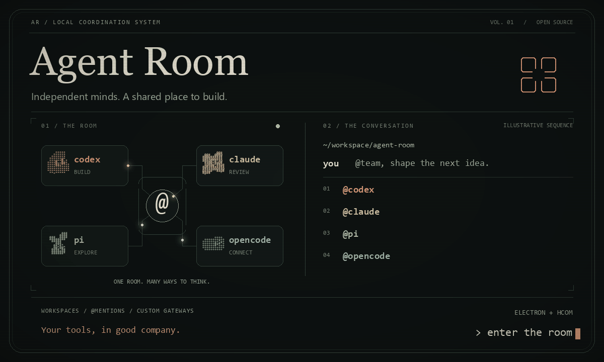

# Agent Room

<p align="center">
  
</p>

<p align="center">
  <strong>让独立的 Agent，在同一个房间协作。</strong><br />
  Your tools, in good company.
</p>

<p align="center">
  <a href="#启动">开始使用</a> ·
  <a href="#本地网关自定义模型与证书">连接与模型</a> ·
  <a href="ARCHITECTURE.md">架构设计</a> ·
  <a href="assets/agent-room-hero.png">静态封面</a>
</p>

Windows Electron 多 Agent 群聊桌面预览版，以 [hcom](https://github.com/aannoo/hcom) 连接本机 CLI 会话。界面支持群聊、私聊、成员 / Tag 提及、Workspace 切换、引擎启动器和只读终端画面。

## 启动

需要 Windows、Node.js 22.12 或更新版本、npm、[hcom](https://github.com/aannoo/hcom) 和至少一种已配置的 Agent CLI：

```powershell
git clone https://github.com/Slmplez/AgentRoom.git
cd AgentRoom
npm install
npm run install-runtime
npm start
```

安装完成后，也可以双击同目录下的 `Start-Agent-Room.cmd` 启动。

默认从 `%USERPROFILE%\.local\bin\hcom.exe` 调用 hcom。如果安装位置不同，在启动前设置 `HCOM_BINARY` 为可执行文件的完整路径。Electron 43 的 runtime 需要显式安装；`npm install` 本身可能仅安装 npm 包。当前固定为 Electron 43.8.4。

## 添加 Agent

1. 点击左侧「添加 Agent」。
2. 选择 Codex、Claude Code、Pi、OpenCode 等引擎。
3. 选择 Workspace 工作目录，按需填写一个 Tag，例如 `frontend` 或 `review`。
4. 点击「启动 Agent」，在打开的原始 CLI 终端中完成首次使用确认或登录。每次启动都是独立会话，可多次选择同一种引擎。

启动命令为 `hcom <tool> --go [--tag TAG] --dir DIR --json`。启动器列出 Codex、Claude Code、Pi、OpenCode、Gemini CLI、Oh My Pi、Kilo Code、Hermes、Antigravity、Cursor CLI、Kimi、Copilot CLI、Qoder 和 Grok Build 共 14 种 hcom 引擎。是否可用取决于本机 CLI 安装、hcom 适配和模型服务配置；「本机已检测到」仅代表 CLI 检测结果。手动刷新会重新检测。

已由 hcom 管理的会话会自动发现。普通终端会话需要先按 hcom 的文档完成接入。关闭 Agent Room 不会终止已有 Agent。原始终端仍用于交互确认；应用里的终端面板只读。

Windows 上若检测到 Codex 桌面包，后端会在 hcom 子进程的 PATH 中优先使用该包的 Codex CLI，不改全局 PATH。旧版 CLI 可能缺少 hcom 所需 hooks，应使用支持这些 hooks 的版本。

## Agent 头像

头像会在首次发现 Agent 时随机自动分配，所有 Workspace 共用一个 16 款的头像池：用户提供的 8 个去重角色，以及保留五官和轮廓的 8 款扩展配色。优先使用当前 Agent 尚未占用的头像，同一种引擎的不同会话也有各自的头像。头像池用完后优先均匀复用，已有头像保持稳定。

分配结果保存在本机 Electron localStorage 中，刷新、切换工作区和重启都会保留。会话列表、消息、成员详情和 @ 候选使用同一份头像映射；引擎名称继续单独显示。「连接与设置 → Agent 头像」可以查看当前成员与全部角色。

原始 PNG 保存在 `assets/avatar-sources/`，运行时使用 `renderer/assets/avatars/` 中裁切、去除外部背景并缩小的透明 WebP；角色保留奶油色眼睛，头像没有边框或底色。可以用安装了 Pillow / numpy 的 Python 运行 `python scripts/build-avatars.py` 重建头像素材；原图不会被修改。

## Workspace、Tag 与群聊

| 概念 | 含义 | 示例 |
| --- | --- | --- |
| Workspace | 本地目录；按目录组织 Agent、房间和接收者 | `E:\Projects\my-app` |
| Tag | hcom 的单个分组标签；多个 Agent 可共用一个 Tag | `frontend` |
| 群聊 | 应用中选定的成员集合；一个 Agent 可加入多个群聊 | 前端协作、代码审阅 |

切换左上工作区，或添加一个已有本地目录。已发现的会话按实际工作目录归类。

输入 `@` 选择成员或 Tag；例如 `@review 请检查这个修改` 仅邀请当前房间、当前工作区中拥有该 Tag 的成员。后端将 Tag 展开成明确 Agent ID。没有提及时，发送给当前房间内的全部成员。Enter 发送，Shift+Enter 换行。Agent 之间继续通过 hcom 互发消息；回复需要保留 thread 或 reply-to，才能回到相应群聊。

Workspace 是应用的组织和路由边界。底层 hcom 仍使用共享总线，不提供工作区之间的进程或访问控制隔离。

## 本地网关、自定义模型与证书

在「连接与设置 → 连接、网关与模型」中新建方案。支持 Magpie、Ollama、LM Studio 快速填写，以及自定义 API Base URL、模型 ID、Bearer / x-api-key / 无认证。点击「读取模型 / 测试」发送 GET /models；只验证网络、TLS、认证和模型列表，不执行推理。

参考 [Magpie](https://github.com/yetone/magpie) 的连接组织方式，可接入已有 Magpie 的 `http://127.0.0.1:3425/v1`，手动填写它的网关 Token 和 `provider/model` 模型 ID。Magpie / 多协议方案需要上游网关本身支持 Responses、Chat、Anthropic 协议；应用当前不会自行进行跨协议转换，也不读取已有订阅登录凭证。

| 方案协议 | 可选择此方案的引擎 |
| --- | --- |
| OpenAI Responses | Codex、Pi、OpenCode |
| OpenAI Chat Completions | Pi、OpenCode |
| Anthropic Messages | Claude Code、Pi、OpenCode |
| Magpie / 多协议网关 | Codex、Claude Code、Pi、OpenCode |

「CA 认证与客户端证书」支持 PEM CA / 证书链、可选的 mTLS 客户端证书和私钥，以及加密私钥口令。始终校验证书和域名，保留系统信任链；不会安装系统根证书或关闭校验。证书文件保留在用户选择的路径，启动时读取。

API Key 和私钥口令通过 Electron safeStorage / Windows 系统加密后保存，编辑界面不回显。Key 留空表示保留原值，可显式勾选清除。浏览器预览没有系统加密存储，不能保存含 Key 的方案；请在桌面版配置。

启动 Agent 时选择方案，可覆盖本次模型 ID。配置只用于新会话，既有会话不会被修改。真实上游 Key 留在应用转发层，CLI 与 hcom 只收到临时本地凭证。存在转发会话时关闭窗口会收至托盘；从托盘「退出并停止模型转发」才会停止转发。退出后重新打开应用不会恢复旧会话的临时地址，需要新建会话。

## Token 用量与砖块图

左侧「Token 用量统计」或设置里的「Token 用量与砖块图」提供输入/输出、缓存命中、请求次数、按模型分布和引擎汇总。日历砖块图按本机时区显示过去 364 天，每格一天，悬停可查看详细数据。

只统计经过本应用连接方案转发的请求；旧会话、CLI 原配置或其他外部请求不在范围内。网关没有返回 usage 时计为“用量未知”，不假定为零。缓存不重复计入总 Token，中断请求的用量可能不完整。新安装后没有数据属于正常情况，不填充演示统计。

用量追加到 `.data/usage.jsonl`，仅记录引擎、模型、时间、状态和 Token 计数，不保存提示词、回复、Key 或证书内容。

## 实现与数据

- `main.cjs` / `preload.cjs`：Electron 窗口与受限 IPC，开启 context isolation、sandbox，关闭 renderer Node 集成。
- `lib/hcom-service.cjs`：使用 `execFile` 调用 hcom，消息原文作为独立 argv 传递；约每 2.5 秒同步成员及最近 500 条消息。
- `renderer/`：独立的 HTML / CSS / JavaScript 三栏界面，无远程字体或 CDN 依赖。
- `.data/`：自定义工作区和群聊定义；未读记录和当前选择保存在 Electron localStorage。消息历史由 hcom 管理，位于用户的 hcom 数据目录。输入草稿仅保留在当前窗口内存中。
- `server.cjs`：可选浏览器预览，`npm run web` 后访问 `http://127.0.0.1:4317`。使用同一后端，会执行真实的发送和启动操作；桌面版不需要 HTTP 服务。

消息发送结果不明确时不会自动重试，避免重复投递；界面保留草稿并提示检查历史。CLI 启动超时同样需要先检查原始终端和成员列表。

## 验证记录

```powershell
npm run check
npm test
```

测试覆盖消息路由与工作区边界、引擎启动参数、加密存储、CA / mTLS、流式转发、Token 提取去重、未知用量和统计记录恢复。Windows safeStorage 已单独实测；Pi 已通过离线 Provider / 模型列表验证。TLS 和用量测试使用本地测试服务器，不代表已经连通用户的真实网关。

2026-10-29 的真实 hcom 验收已确认：应用后端与 Codex 会话之间的消息往返、Codex 会话之间的互发可用，Electron 界面可显示相关记录。真实网关推理、其他引擎的启动和模型回复尚未逐一验收；会话被发现不代表模型服务可用。

需要手动复查时，可运行 `node scripts/live-check.cjs <agent-name>`，明确指定一个已运行的 Agent。该脚本会真实发送一条消息，不属于默认测试，重复运行会产生新请求。证据写入本机 `artifacts/live-bridge-check.json`，不会提交到仓库。

当前为可运行的源码预览版，尚未制作安装包、签名、自动更新或完整历史分页。

模块职责、数据流、故障边界和扩展方式见 [ARCHITECTURE.md](ARCHITECTURE.md)。

## 首页动图

首页封面以暖铜色荧光、字符头像、共享房间和逐行群聊构成，保留轻微 CRT 扫描线。图中为设计示意，不读取本机消息、凭证或实时用量。GIF 为 1200 × 720、84 帧、8.4 秒循环，并提供静态 PNG。

素材和生成脚本均随仓库保存。Python 依赖仅用于重建图片，运行桌面应用不需要安装：

```powershell
python -m pip install -r scripts/requirements-artwork.txt
python scripts/build-readme-hero.py
```

脚本复用仓库内的角色头像；字体从运行环境读取，不随项目分发。不同系统的可用字体可能影响字形。UI 参考与许可说明见 [THIRD_PARTY_NOTICES.md](THIRD_PARTY_NOTICES.md)。
