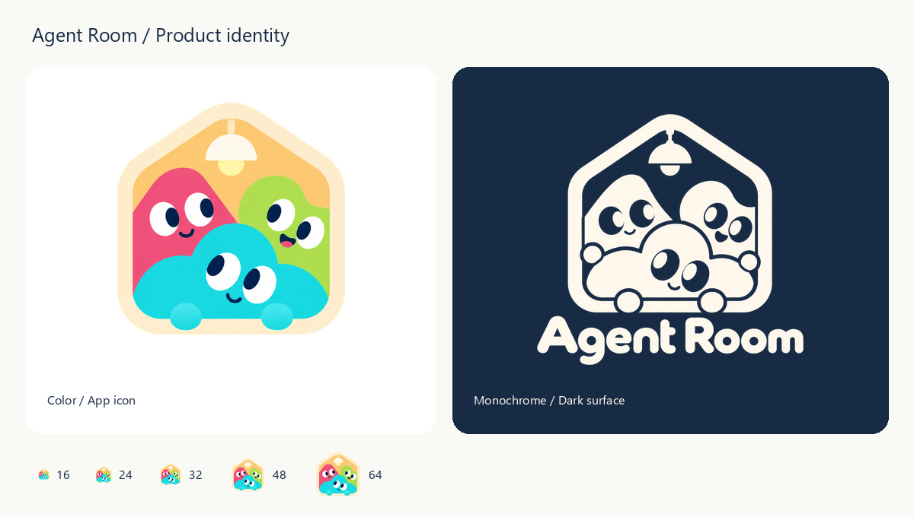

# Agent Room

<p align="center">
  
</p>

<p align="center">
  <strong>让独立的 Agent，在同一个房间协作。</strong><br />
  Your tools, in good company.
</p>

<p align="center">
  <a href="#启动">开始使用</a> ·
  <a href="#本地网关自定义模型与证书">连接与模型</a> ·
  <a href="ARCHITECTURE.md">架构设计</a> ·
  <a href="assets/agent-room-hero.png">静态封面</a>
</p>

Windows Electron 多 Agent 群聊桌面预览版，内置基于 [hcom](https://github.com/aannoo/hcom) 源码构建的 Rust 原生核心。支持群聊、私聊、成员 / Tag 提及、Workspace、多引擎无终端 RPC 会话、流式回复与应用内权限确认，无需独立安装或启动 hcom。

## 工作台界面

界面参考 [Caho1/open-claude-ui](https://github.com/Caho1/open-claude-ui) 的中性色、陶土色强调和简洁对话排版，按多 Agent 协作重新组织：左侧管理工作区与会话，中间为对话和输入区，右侧查看工作环境、成员、Tag 与会话状态入口。右上角可切换浅色 / 深色；侧栏和详情面板可收起，选择会自动保存在本机。

原生桌面启动器支持 Codex、Claude Code、Pi、OpenCode；其他上游引擎暂未开放原生启动。欢迎页的任务建议只填入草稿，由用户继续编辑和发送。

| 快捷键 | 操作 |
| --- | --- |
| `Ctrl+N` | 新建群聊 |
| `Ctrl+B` | 展开 / 收起侧栏 |
| `Ctrl+K` | 搜索会话或成员 |
| `Enter` / `Shift+Enter` | 发送 / 换行，兼容中文输入法组字 |

设计参考和许可见 [THIRD_PARTY_NOTICES.md](THIRD_PARTY_NOTICES.md)。界面使用系统字体，不加载远程字体或 CDN。

开发界面时可运行 `npm start -- --ui-preview`，使用独立的窗口偏好和应用数据目录。该模式同样使用内置原生核心，发送和启动按钮会执行真实操作。

## 应用标志

产品 Logo 使用用户提供的“小屋、吊灯与三个 Agent”图案。彩色版用于标题栏、Windows 窗口 / 任务栏及浏览器 favicon；带 Agent Room 字样的单色版用于欢迎页，随深浅主题切换深蓝 / 米白。透明底导出保留原图构图，16–256 px 图标按比例缩放。

两张原图原样保存在 `assets/brand/sources/`。运行 `python scripts/build-brand.py` 可重建透明底 PNG、多尺寸 ICO 和品牌预览图，需要 Pillow / NumPy；这些导出为位图，不声称是矢量重绘。旧方案脚本保存在 `scripts/build-brand-legacy.py`。运行中的 Electron 窗口需要重启后加载新的任务栏图标。



## 启动

源码开发需要 Windows x64、Node.js 22.12 或更新版本、npm、Rust 1.92.0 MSVC、Visual Studio C++ Build Tools / Windows SDK，以及至少一种 Agent CLI：

```powershell
git clone https://github.com/Slmplez/AgentRoom.git
cd AgentRoom
npm install
npm run install-runtime
npm run build:native
npm start
```

安装完成后，也可以双击同目录下的 `Start-Agent-Room.cmd` 启动。

桌面版按 `native/bin/runtime.json` 加载对应构建目录的 `agent_room_hcom.node`，由 Electron 自动管理核心与会话进程。同目录的 `hcom.exe` 供 hooks / Agent 命令兼容调用，无需全局安装。按内容指纹保留构建，避免覆盖运行中的 Windows DLL；新构建在下次启动应用时生效。Electron runtime 需要显式安装，当前固定为 43.8.4。原生核心缺失时提示构建，不会静默使用外部 hcom。

## 添加 Agent

1. 点击左侧「添加 Agent」。
2. 选择 Codex、Claude Code、Pi、OpenCode 等引擎。
3. 选择 Workspace 工作目录，按需填写一个 Tag，例如 `frontend` 或 `review`。
4. 点击「启动 Agent」，RPC 就绪后直接在聊天中 @ 它；回复流式显示在原会话。点击成员的会话按钮查看状态、处理权限、回答问题、中断任务或停止 Agent。每次启动都是独立会话，可多次选择同一种引擎。

应用通过 Codex app-server、Pi RPC、Claude stream-json 或 OpenCode HTTP/SSE 直接控制 CLI，不创建 PTY 或终端窗口，也不自动回退到终端模式。「本机已检测到」仅代表 CLI 检测结果，初始化成功后才返回就绪。模型服务需单独配置和验证。

账号登录请预先在对应 CLI 中完成，或选择已配置的连接方案。详细协议、投递语义与各引擎实际验收范围见 [无终端 RPC 模式](docs/RPC-MODE.md)。

桌面版使用应用私有的 hcom 数据目录，保留应用外的既有会话。关闭会话面板保留会话；有活跃会话或模型网关时关闭主窗口进入托盘，明确退出会停止本应用托管的会话和网关。

Windows 上若检测到 Codex 桌面包，后端会在 hcom 子进程的 PATH 中优先使用该包的 Codex CLI，不改全局 PATH。CLI 版本需支持对应 RPC 协议；RPC 不依赖 PTY hooks。

## Agent 头像

头像会在首次发现 Agent 时随机自动分配，所有 Workspace 共用一个 16 款的头像池：用户提供的 8 个去重角色，以及保留五官和轮廓的 8 款扩展配色。优先使用当前 Agent 尚未占用的头像，同一种引擎的不同会话也有各自的头像。头像池用完后优先均匀复用，已有头像保持稳定。

分配结果保存在本机 Electron localStorage 中，刷新、切换工作区和重启都会保留。会话列表、消息、成员详情和 @ 候选使用同一份头像映射；引擎名称继续单独显示。「连接与设置 → Agent 头像」可以查看当前成员与全部角色。

原始 PNG 保存在 `assets/avatar-sources/`，运行时使用 `renderer/assets/avatars/` 中裁切、去除外部背景并缩小的透明 WebP；角色保留奶油色眼睛，头像没有边框或底色。可以用安装了 Pillow / numpy 的 Python 运行 `python scripts/build-avatars.py` 重建头像素材；原图不会被修改。

## Workspace、Tag 与群聊

| 概念 | 含义 | 示例 |
| --- | --- | --- |
| Workspace | 本地目录；按目录组织 Agent、房间和接收者 | `E:\Projects\my-app` |
| Tag | hcom 的单个分组标签；多个 Agent 可共用一个 Tag | `frontend` |
| 群聊 | 应用中选定的成员集合；一个 Agent 可加入多个群聊 | 前端协作、代码审阅 |

切换左上工作区，或添加一个已有本地目录。已发现的会话按实际工作目录归类。

输入 `@` 选择成员或 Tag；例如 `@review 请检查这个修改` 仅邀请当前房间、当前工作区中拥有该 Tag 的成员。后端将 Tag 展开成明确 Agent ID。没有提及时，发送给当前房间内的全部成员。Enter 发送，Shift+Enter 换行。Agent 之间继续通过 hcom 互发消息；回复需要保留 thread 或 reply-to，才能回到相应群聊。

Workspace 是应用的组织和路由边界。底层 hcom 仍使用共享总线，不提供工作区之间的进程或访问控制隔离。

## 本地网关、自定义模型与证书

在「连接与设置 → 连接、网关与模型」中新建方案。支持 Magpie、Ollama、LM Studio 快速填写，以及自定义 API Base URL、模型 ID、Bearer / x-api-key / 无认证。点击「读取模型 / 测试」发送 GET /models；只验证网络、TLS、认证和模型列表，不执行推理。

参考 [Magpie](https://github.com/yetone/magpie) 的连接组织方式，可接入已有 Magpie 的 `http://127.0.0.1:3425/v1`，手动填写它的网关 Token 和 `provider/model` 模型 ID。Magpie / 多协议方案需要上游网关本身支持 Responses、Chat、Anthropic 协议；应用当前不会自行进行跨协议转换，也不读取已有订阅登录凭证。

| 方案协议 | 可选择此方案的引擎 |
| --- | --- |
| OpenAI Responses | Codex、Pi、OpenCode |
| OpenAI Chat Completions | Pi、OpenCode |
| Anthropic Messages | Claude Code、Pi、OpenCode |
| Magpie / 多协议网关 | Codex、Claude Code、Pi、OpenCode |

「CA 认证与客户端证书」支持 PEM CA / 证书链、可选的 mTLS 客户端证书和私钥，以及加密私钥口令。始终校验证书和域名，保留系统信任链；不会安装系统根证书或关闭校验。证书文件保留在用户选择的路径，启动时读取。

API Key 和私钥口令通过 Electron safeStorage / Windows 系统加密后保存，编辑界面不回显。Key 留空表示保留原值，可显式勾选清除。浏览器预览没有系统加密存储，不能保存含 Key 的方案；请在桌面版配置。

启动 Agent 时选择方案，可覆盖本次模型 ID。配置只用于新会话，既有会话不会被修改。真实上游 Key 留在应用转发层，CLI 与 hcom 只收到临时本地凭证。存在转发会话时关闭窗口会收至托盘；从托盘「退出并停止模型转发」才会停止转发。退出后重新打开应用不会恢复旧会话的临时地址，需要新建会话。

## Token 用量与砖块图

左侧「用量统计」或设置里的「Token 用量与砖块图」提供输入/输出、缓存命中、请求次数、按模型分布和引擎汇总。日历砖块图按本机时区显示过去 364 天，每格一天，悬停可查看详细数据。

只统计经过本应用连接方案转发的请求；旧会话、CLI 原配置或其他外部请求不在范围内。网关没有返回 usage 时计为“用量未知”，不假定为零。缓存不重复计入总 Token，中断请求的用量可能不完整。新安装后没有数据属于正常情况，不填充演示统计。

用量追加到 `.data/usage.jsonl`，仅记录引擎、模型、时间、状态和 Token 计数，不保存提示词、回复、Key 或证书内容。

## 实现与数据

- `main.cjs` / `preload.cjs`：Electron 窗口与受限 IPC，开启 context isolation、sandbox，关闭 renderer Node 集成。
- `lib/hcom-service.cjs`：房间、工作区与网关用例编排；桌面注入 `RpcRuntime`；`lib/rpc/` 适配四种控制协议，native utility process 提供持久 hcom 总线。
- `renderer/`：独立的 HTML / CSS / JavaScript 三栏界面，无远程字体或 CDN 依赖。
- `.data/`：开发桌面版的工作区、群聊与配置；hcom 消息历史保存在 `.data/runtime`。发布版改用 Electron `userData`，UI 预览使用独立目录。未读记录和当前选择保存在 Electron localStorage，输入草稿仅保留在当前窗口内存中。
- `server.cjs`：使用相同 RPC runtime 的浏览器预览，`npm run web` 后访问 `http://127.0.0.1:4317`，数据隔离在 `.data/web-rpc`；不依赖全局 hcom。它会执行真实操作；桌面版不需要 HTTP 服务。

消息发送结果不明确时不会自动重试，避免重复投递；界面保留草稿并提示检查历史。CLI 结果未知时停止该会话，需检查聊天记录与会话状态后再决定是否新建或重发。

## 验证记录

```powershell
npm run check
npm test
npm run verify:capabilities-ui
npm run verify:capability-clis
```

测试覆盖消息路由与工作区边界、引擎启动参数、加密存储、CA / mTLS、流式转发、Token 提取去重、未知用量和统计记录恢复。Windows safeStorage 已单独实测；Pi 已通过离线 Provider / 模型列表验证。TLS 和用量测试使用本地测试服务器，不代表已经连通用户的真实网关。

2026-10-29 的旧外部 hcom 验收已确认应用后端与 Codex 会话的消息往返及 Codex 会话之间的互发；这不替代原生后端验收。原生版已通过 Rust 模块、双 ConPTY 会话、消息与输入隔离、会话退出清理以及真实 Electron utility process 验证。真实 Pi 加载会话级 Provider 和 hcom 扩展后，通过应用网关连接本地模拟推理服务，实际执行 bash/hcom 回复，并生成隔离的测试用量记录。

运行 `node scripts/verify-native.cjs` 和 `node scripts/verify-native-pi.cjs` 可复验原生链路；后者需要本机安装 Pi。上述原生测试没有付费模型调用。当前默认 RPC 已通过真实 Codex、Pi、OpenCode 与本地模拟模型的完整往返，Pi 还通过真实工具定向互发及 Electron 宿主验证；终端事件与 PTY 数均为 0。Claude 的协议适配已测试，但本机 CLI 启动报 Bun 语法错误，真实推理尚未验收。复验命令和范围见 [RPC 验证记录](docs/RPC-MODE.md)。真实远程网关需单独验收。

需要手动复查时，可运行 `node scripts/live-check.cjs <agent-name>`，明确指定一个已运行的 Agent。该脚本会真实发送一条消息，不属于默认测试，重复运行会产生新请求。证据写入本机 `artifacts/live-bridge-check.json`，不会提交到仓库。

当前为可运行的源码预览版，尚未制作安装包、签名、自动更新或完整历史分页。

原生融合的源码依据、进程设计、构建与验收见 [NATIVE-INTEGRATION.md](NATIVE-INTEGRATION.md)；网关和统计边界见 [ARCHITECTURE.md](ARCHITECTURE.md)。

## 首页动图

首页封面以暖铜色荧光、字符头像、共享房间和逐行群聊构成，保留轻微 CRT 扫描线。图中为设计示意，不读取本机消息、凭证或实时用量。GIF 为 1200 × 720、84 帧、8.4 秒循环，并提供静态 PNG。

素材和生成脚本均随仓库保存。Python 依赖仅用于重建图片，运行桌面应用不需要安装：

```powershell
python -m pip install -r scripts/requirements-artwork.txt
python scripts/build-readme-hero.py
```

脚本复用仓库内的角色头像；字体从运行环境读取，不随项目分发。不同系统的可用字体可能影响字形。UI 参考与许可说明见 [THIRD_PARTY_NOTICES.md](THIRD_PARTY_NOTICES.md)。

## Agent 上下文与统一能力库

成员列表和私聊头部以圆环显示上下文占比，右侧成员详情保留 Token 数值。虚线横杠表示尚未获取；虚线圆点表示已获取用量但上限未知；实线空环表示已知为零。悬停查看来源、上限与更新时间，累计用量仍在独立看板中。

Codex 读取 hcom 绑定会话的原生 Token 记录。应用新启动的 Pi 会话自动加载独立的上下文扩展，从 Pi 引擎读取当前占用与模型上限，不要求使用应用网关；扩展仅在 `.data/context/` 写入会话指标。旧 Pi 会话回退到绑定的会话记录，校验会话和工作目录，并仅读取当前末叶分支、最近成功请求的用量。模型切换或压缩后等待新记录，全零错误请求不会显示为 0%。其他引擎经应用网关启动时使用最近请求用量。配置上限与引擎报告上限分别标注；升级不会向运行中的 Pi 注入扩展，后端更新在应用下次启动后生效。

左侧「能力库」已支持统一 MCP / Skills：添加 stdio、HTTP 或 SSE 服务，测试连接并选择启用的工具；导入本地 Skill 目录；为工作区设置默认分配，或在启动 Agent 时自定义本次能力。Skills 经统一 MCP 入口按需读取，保留完整脚本 / 资源及固定版本，不修改各 CLI 的全局配置。Codex、Claude Code、Pi、OpenCode 已接入会话配置。

操作方式：能力库 → 添加 MCP / 导入 Skill → 工作区分配 → 启动 Agent。已有会话保留原分配，新配置在新会话中生效；全局 MCP 停用和工具禁用会阻止已有会话的后续调用。实现边界与 Magpie 源码依据见 [能力库设计](docs/CAPABILITY-HUB.md)。
