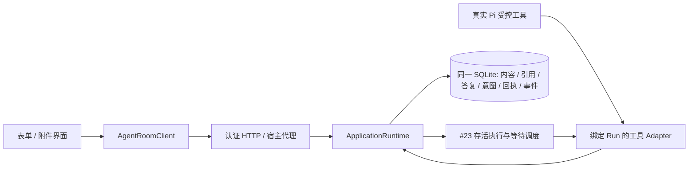

# #24 表单动作与附件实施规格

状态：规则已冻结，等待 #37 实施完成并整合后交接共享运行时。基线 `30c8f1c`；本提交仅新增文档，不修改共享代码。

本轮授权扩展为真实复杂表单提交、明确继续原任务、认证附件上传/下载。它取代旧方案中把这些能力永久后置的范围描述，但不改变原报告不可变版本、单用户身份、禁止模型 JS、unknown 不重放的规则。#17/#18 已从本轮范围移除，不作为实现前置。保留设置中的记忆管理，以及报告/Diff 的简短和完整预览。

## 已有实现与缺口

| 基线事实 | 本轮增量 |
| --- | --- |
| ApplicationRuntime.execute 拥有实体、事件与回执事务；schema v5 | 新表由这一事务拥有者提交，迁移号等 #23 合入后递增，不预占版本 |
| artifact_versions 保存只读报告；Message.artifactRefs 固定版本 | 增加 form 类型与固定 schema；旧报告缺省仍按 report 解读 |
| 真实 Pi 发布桥接绑定 Task/Run/incarnation；启动可固定记忆快照 | 表单工具沿用同一身份绑定和原始上下文，不另建任务执行器 |
| 原生问题答复目前同时保存并投递 | 表单需要“已保存答复”和“已请求继续”的独立事实，不能复用自动继续的按钮语义 |
| 认证 HTTP + 宿主 cookie 代理，JSON 写入上限 128 KiB | 独立有界二进制上传、鉴权下载及响应头透传；不提高所有 JSON 路由限额 |
| Client 持久命令日志只保存可序列化参数 | 文件字节不放 localStorage；日志仅保存文件元数据、摘要与原 key |
| 真实右侧报告和 Mock 表单演示 | 新建生产受限表单组件，原 Mock 不作为实现证据 |

## 固定表单目录

表单是不可变版本产物，`kind: form`、`catalogVersion: 1`，独立于只读 report v1。公开引用增加 kind，旧引用默认 report。后端、Client 与 UI 使用同一表单契约；不把复杂表单混入原 reportSchema。

| 项目 | 固定规则 |
| --- | --- |
| 大小 | 定义正文最多 64 KiB UTF-8；提交值最多 64 KiB；HTTP JSON 请求仍至多 128 KiB |
| 结构 | 最多 6 个分组、20 个字段；分组仅一层，不支持递归或任意 JSON Schema |
| 字段 ID | 1–64 字符，`[A-Za-z][A-Za-z0-9_]*`，全表唯一，拒绝原型键 |
| 文案 | 标题/字段标签最多 200；说明最多 2000；一律普通文本 |
| 类型 | text、textarea、number、select、multiselect、checkbox、date、attachments |
| 文本 | 单行最多 500，多行最多 4000；required 空白无效；不偷偷改写已提交原文 |
| 数值 | JSON number，有限且绝对值不大于 1e12；支持有限 min/max 与 integer 标志，不做字符串隐式转换 |
| 选项 | 每字段最多 30 个固定选项，ID 唯一；多选去重且不超过定义的选择数上限 |
| 日期 | 严格有效 Gregorian `YYYY-MM-DD`，不用本地时区隐式变换；可选固定 min/max |
| 附件字段 | 最多 5 个同房间附件 ID；只能引用有权访问的已上传内容，不接受路径/URL/内联 base64 |
| 初始值 | 发布时按同一校验器验证；不得接受额外字段 |
| 禁止项 | 模型 JS、HTML、正则脚本、表达式、动态 URL、任意绑定、条件代码、远程选项、嵌套可执行动作 |

命名动作由宿主固定为 `record_response` 和 `resume_task`。模型只能请求这种表单，不得注册任意 action handler、命令、网络请求或目标任务。按钮文案固定为“提交答复”和“继续原任务”，显示实际任务目标和负责人。

## 发布、答复与明确继续

1. 可信宿主显式启用 `--agent-forms`（要求已有 `--agent-workspace` 和 `--agent-reports`）。默认任务不获得表单工具。
2. Pi 调用 `request_form({key, artifactId?, expectedVersion, title, spec})`。Task/Run/Agent/incarnation 来自宿主绑定；同一 Run 同时至多一个人类等待，沿用 #23 的等待互斥规则。
3. 一次事务发布不可变定义、精确消息引用、当前等待事实和回执。工具 Adapter 在已注册的原生调用上等待答复；应用的私有等待标识不进入模型参数或公开 DTO。
4. 真人 `submitForm({key, roomId, artifactId, version, expectedResponseRevision, values})`。核对房间权限、当前产物版本、等待归属与字段值。保存不可变答复修订、回答者、附件引用、摘要消息、事件与回执；任务仍等待，不能因 submit 自动投递。
5. 继续前可以明确更正已保存答复：提交新修订，必须带 expectedResponseRevision。两客户端竞争仅一方成功，另一方保留本地草稿并展示冲突。旧版本或失效等待不可新提交；已提交历史仍可读。
6. 真人点击“继续原任务”，提交 `continueForm({key, roomId, artifactId, version, responseRevision, expectedWaitRevision})`。服务端重新核对当前版本、精确答复修订和仍存活的原 Task/Run/incarnation，事务保存一次投递意图与回执。未保存或已修改的草稿不能作为继续内容。
7. #23 的执行调度在提交后领取意图，先记录 attempting，再向唯一的原等待交付冻结值。模型收到结构化工具结果继续同一轮次；不创建替代 Task、不广播、不重建提示或重新加载已改动的记忆。
8. 等待已经满足后，重复的同 key 仅查询原回执；新 key 不产生第二次交付。允许同一存活任务在继续后发布同一 form 的下一版，必须检查 expectedVersion。历史定义和已保存答复不变，旧客户端不能提交旧版。
9. 发布/提交/继续均有独立幂等键和指纹；同 key 改内容冲突。超时先查原 key，不自动换 key 或重放工具。保存成功不等于投递成功，投递成功不等于任务验收。

等待与投递使用 #23 最终提供的存活执行 Interface：绑定身份、注册等待、事务记录继续意图、单次投递、失效通知。交接后确定内部方法名与状态枚举，不并行实现第二个队列。若 #23 仍只有“保存即投递”的路径，需要在其已验收提交之上增加这条显式继续路径，不能悄悄退化为 submit 自动跑。

### 中断规则

- 页面关闭不取消后台等待；重开从数据库读取定义、已保存答复和操作状态。本地未提交草稿按 database/user/room/artifact/version 保存，不进入共享事实。
- 服务停止、引擎断开、原等待过期或撤销后不能继续旧 incarnation。保存的答复和产物保留，等待明确 expired/unknown。
- 提交前崩溃：无答复/意图/回执；提交后响应丢失：原回执可查；投递 attempting 后失联：unknown，不因重启、轮询、收到旧回执而重发。
- 仅以引擎可观察到的交付边界更新状态，不把 HTTP response.finish 当作模型已执行。不能声称跨 SQLite/CLI 的 exactly-once。
- 用户想在丢失原执行后重新开展工作，必须创建新的显式任务；本轮不自动恢复该调用。

## 附件：限额、类型与原子保存

选择同库 SQLite BLOB，避免外部 blob 文件 rename 与数据库提交之间的悬空引用。基线已有目录隔离和 WAL；首版上限足够小，不新增对象存储、文件服务器或任意路径访问。

| 项目 | 固定值 / 行为 |
| --- | --- |
| 单文件 | 1 byte–8 MiB；按实际接收字节校验，不能只相信 Content-Length |
| 每消息 / 每次表单答复 | 最多 5 个附件，总计至多 20 MiB |
| 数据库内容额度 | 256 MiB，含待发送附件；按数据库事务检查，超额明确拒绝 |
| 前端上传 | 顺序上传，用户可取消；服务端同时至多 2 个上传体接收，额外请求返回明确忙碌状态，不隐式排队重试 |
| 未发送内容 | 暂存 24 小时，界面标明期限；到期分批回收未引用内容。已关联消息/表单的附件不自动回收 |
| 文本类型 | .txt、.md、.csv、.json、.log，要求合法 UTF-8，拒绝 NUL；作为文件处理，不执行或自动导入 |
| 二进制类型 | .pdf、.png、.jpg/.jpeg、.webp，校验扩展名与基础文件签名一致；不声称签名校验等于病毒检测 |
| 暂不支持 | 可执行文件、脚本、HTML/SVG、压缩包、Office、目录、符号链接、远程 URL 抓取 |
| 显示名称 | NFC，最多 160 字符 / 240 UTF-8 bytes；拒绝分隔符、冒号、控制字符、CRLF、双向控制字符、`.`/`..`、Windows 保留名、尾随点/空格。名称不用作存储路径 |

### 上传、关联和下载

- 认证 `POST /api/v1/rooms/:roomId/attachments`：单文件 application/octet-stream；有界元数据包含显示名、声明类型与原 key；后端计算实际 size/SHA-256，独立检查内容与额度。扩展名/声明类型不匹配拒绝；无认证先拒绝再读取大正文。
- 在 ApplicationRuntime 的同一事务保存内容、attachment 元数据、上传者/房间、pending 状态、事件和回执。摘要相同但 room 不同不复用公开附件身份，不暴露全局内容是否存在。事件仅含元数据，绝不含 bytes/base64。
- UI 选择文件只上传至暂存列表，不自动发送消息或执行。Client 提供明确的文件传输 Interface，文件 Blob 只停留在本次调用内；网络 Adapter 处理二进制，页面不直接 fetch/IPC。
- `sendDiscussion` 可携带 attachmentIds；发送时原子验证同房间、当前用户可使用、未过期且额度满足，关联消息并把 pending 改为 linked。允许只有附件、没有正文；没有正文且没有附件仍拒绝。表单提交沿用同一引用验证。绑定事务与上传事务各自有幂等回执，不把“暂存成功”当成“消息已发送”。
- 移除未发送附件是显式命令，只能移除本人、同房间、未引用内容，事务删除内容并保存删除回执。已发布引用不可通过这一命令删除。
- 响应未知时日志保留 fileName/size/SHA-256/room/key，不保存字节、本机路径或句柄。先查原上传回执；确认未找到后，只有用户重新选择摘要一致的文件才可显式重试同 key。不能刷新后自动重新读取磁盘。
- 查询元数据与下载都鉴权并核对房间。pending 仅上传者可用；已关联内容受房间访问控制。读取前检查摘要与实际长度，损坏返回 attachment_unavailable，不能下载伪造空文件。
- `GET /api/v1/rooms/:roomId/attachments/:id/content` 仅按不透明 ID 下载。`Content-Disposition: attachment`，安全 ASCII fallback + RFC 5987 UTF-8 filename；`Content-Type: application/octet-stream`、nosniff、no-store，明确 Content-Length。首版不提供 inline HTML/图片/PDF 或 Range 下载。
- 宿主代理只透传经后端生成的下载头；认证 Cookie/Bearer 不放入 URL。Client 返回已验证 Blob 和安全文件名，由受控下载控件触发；用后释放 object URL，不调用 shell。
- 附件不会自动写入工作目录、执行、解析成记忆或塞入模型提示。表单工具结果可包含授权附件 ID、名称、类型、摘要；模型二进制解析与任意磁盘导入不属于本轮。

## 界面与契约

报告仍沿用 kind=report 的简短/完整显示。form 在简短预览展示目的、字段数、状态和来源，“填写表单”进入完整受限控件；不在摘要视图隐藏提交/继续状态。显示“草稿 / 已保存答复 rN / 待确认继续 / 已请求投递 / 已投递 / 结果未知 / 已失效”。不使用一个“成功”覆盖这些不同事实。

切房间、版本、关闭面板后丢弃晚到读取结果；冲突不覆盖草稿；离线不能提交或继续。响应未知必须先核查原操作。保留来源与历史版本、Escape/焦点归还、键盘选择、IME、防重复点击、窄屏返回、reduced-motion，以及当前设置内的记忆入口。

附件在 composer 和 form 中展示名称、大小、上传/待核查/就绪/过期状态，发送前可移除；消息和历史只带 attachmentRefs。下载状态与发送状态分开，下载错误不能触发重发消息。

## 文件归属与顺序

目前仅拥有本方案及 docs/tickets/ 下两份草案。#23 先拥有共享 runtime/http/contracts/Client/UI；其实施票 #37 完成验收并合入 main 后，本会话再从其精确提交同步、确认干净状态，串行实施：

1. 附件完整切片：contracts/attachments.mjs、ApplicationRuntime 内部 attachments 模块、storage/index、application-http、persistence-host、Client 文件传输、composer/thread、测试与文档。
2. 表单完整切片：contracts/artifact-forms.mjs、artifacts/form-response 内部逻辑、#23 已交接的执行等待 Adapter、Pi 工具注册、HTTP/Client、独立 artifact-form.tsx、artifact-view/app 入口、测试与文档。

遵守 execute/query 的应用事实入口；二进制传输可增加窄的 Client upload/download Interface，但不让 HTTP handler 自行提交事务。Runtime 内部接收有界字节载体并计算指纹，公开 JSON 命令/事件不携带 Node Buffer 或本机路径。

正式票据：[附件 #38](https://github.com/Slmplez/AgentRoom/issues/38) 与 [表单 #39](https://github.com/Slmplez/AgentRoom/issues/39)，本地镜像见 [附件验收票](tickets/artifact-attachments.md) 和 [表单验收票](tickets/artifact-forms.md)。#38 原生依赖 #37；#39 原生依赖 #38/#37；两票都是 #24 原生子 Issue，均已明确但等待依赖，不凭 ready-for-agent 绕过依赖。

## 交付验收

- 真 SQLite + HTTP 双客户端：上传/下载字节哈希一致；大小、类型、文件名、额度、同 key 冲突、跨房间、过期/删除/缺失内容；事件和回执不泄露内容或路径。
- 子进程在上传存储、附件绑定、表单提交、继续意图提交前后强杀：全部或无，旧回执可核查，无悬空已发布引用、无第二次原生执行。
- 真实已安装 Pi + 回环推理：发布真实表单 → 真人填写保存 → 观察没有第二次模型调用 → 明确继续 → 原工具收到冻结值 → 同一任务继续并产生结果。重启 unknown 不自动重跑。
- 桌面/Web：文件选择、暂存、消息关联、真实下载；表单字段校验、两端修订冲突/草稿、响应丢失、窄屏与主题截图、IME/键盘；既有报告/Diff/记忆/问题 UI 回归。
- 明确区分本机受控推理验证与外部供应商验证。父票 #24 由监督在全部子切片整合后验收，本会话不直接关闭。

## #25 Magpie 实机验证环境交接

2026-10-31 本轮只读检查：PATH 未发现 `magpie` 命令，127.0.0.1:3425 在 1.5 秒连接探测中不可达。只能据此确认默认入口不可用，不能断言机器不存在自定义安装或其他端口。

已合入的是模型目录、可选连接预设和本地三协议工具流夹具。实机验证还需要：可运行的 Magpie 程序及版本、实际监听地址/启动方式、已配置且允许调用的供应商路由、至少一个支持工具调用和流式输出的模型，以及可用认证方式。凭据由用户现有受控配置或设置界面保存，不读取/输出密钥，不把模型列表成功当作推理成功。

随后指定 UI 会话完成了实机验证，交付 `ed42314ea6f1eace382bf0424c746cabbd5f4d34`（base `30c8f1c`）。已只读核对其 docs/MAGPIE-REAL-VALIDATION.md 和脱敏证据：官方 Windows CLI v0.1.2286、真实网关加受控上游通过目录/工具流续接/错误/取消；外部 DeepSeek `deepseek-flash` 完成文本、工具调用与结果续接，共 3 次推理、398 tokens。此更新覆盖“尚缺实机证据”的旧结论，不保证其他供应商或取消后的计费停止。

当前是等待监督收取该验证提交；不是等待用户发送密钥。重跑所需 CLI 位于该会话忽略目录，需显式 MAGPIE_TEST_BINARY；外部重跑仍需可用认证和付费调用授权，不自动复跑。本会话未安装/启动 Magpie、未读取密钥或发起外部推理，验证证据来自上述专项会话。
