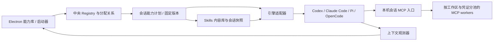

# 统一 MCP、Skills 与 Agent 上下文

状态：**统一能力库、MCP Hub、Skills 按需读取与启动分配已实现。** 下文保留的完整目标架构中，尚未落地的部分会单独标明。

## 当前实现与入口

左侧导航点击「能力库」，可切换 MCP 服务、Skills、工作区分配。添加 Agent 时，「本次能力」支持继承工作区默认、自定义和本次不使用。右侧成员详情显示分配的能力名称以及等待连接 / 已连接 / 已停止状态；已连接表示收到真实 MCP 请求，不表示模型已执行过工具。

| 功能 | 已实现行为 |
| --- | --- |
| MCP 管理 | 新建 / 编辑 / 移除 stdio、Streamable HTTP、SSE 服务；保存后可测试连接并查看工具，测试不执行工具 |
| 认证 | 环境变量 / Headers 经 Electron 系统加密保存，不回显值；留空保留，填写 `{}` 清空 |
| 工具控制 | 测试结果中的复选框与禁用名称数组联动，保存后既不能列出也不能调用；全局停用 / 移除会回收应用拥有的进程 |
| Skills | 从本地包含 SKILL.md 的目录导入完整文件树；固定内容哈希快照；更新生成版本，旧会话保留旧版本；校验读取内容完整性，拒绝目录穿越与符号链接 |
| 分配 | 工作区默认配置持久化；启动时生成独立会话计划，支持本次覆盖；已有会话不随默认分配变化 |
| 共享与隔离 | MCP 默认每 Agent 独享；显式选择工作区共享时，按服务 revision / 工作区 / 目录复用，引用归零后清理；空闲 10 分钟回收并按需重启 |
| 引擎 | Codex 会话 config override、Claude 会话 mcp-config、OpenCode inline config 合并、Pi 显式扩展桥接 |

本版 Skills 的统一加载方式是 MCP 工具 `ar_skills_list` 和 `ar_skills_read`。模型先发现元数据，再读取所需说明；返回值还包含本地快照目录，供 CLI 访问脚本和资源。**不接管、改写或冒充各 CLI 的原生 Skills 目录。** 因而同一个 Workspace 内不同 Agent 可以获取不同的 Skills 清单。现有 CLI 自带 Skills / MCP 继续按其原有规则加载。

配置保存在应用数据目录 `capabilities/library.json`，快照在 `capabilities/skills/<id>/<hash>`。敏感 map 以 `encryptedSecrets` 存入 Registry；MCP 会话口令只在内存或子进程会话配置中传递，上游凭证不注入 CLI。Hub 按需开启随机 localhost 端口，校验 Host、Origin 与会话独立 Bearer 凭证。

代码入口：

- `lib/capability-library.cjs`：串行原子存储、加密、Skills 导入 / 版本、工作区绑定。
- `lib/mcp-hub.cjs`：官方 MCP SDK、HTTP 会话入口、stdio / HTTP / SSE 上游、工具命名和权限、worker 生命周期、Skills 读取。
- `lib/capability-launch.cjs`：四引擎会话配置与生成式 Pi 桥接。
- `lib/hcom-service.cjs`：启动编排、会话归属、状态、退出清理。
- `renderer/capabilities.js` / `capabilities.css`：管理界面、测试、分配与启动选择。
- `main.cjs` / `preload.cjs` / `server.cjs`：受限 IPC 与本机浏览器预览路由。

当前边界：Hub 的 HTTP 调度位于 Electron 主进程，stdio 服务各自是独立子进程；独立 Hub utility process 尚未迁移。只代理 tools 和工作区 roots；未实现 OAuth 登录、MCP 自定义 TLS、resources / prompts 聚合、Git URL 直接导入、原生 Skills 目录同步及运行中重载。Pi 桥接在启动时注册工具，工具清单结构更新后需要新建会话；已禁用工具即使仍被 CLI 缓存，也会被 Hub 拒绝调用。

验证：`node --test test/capabilities.test.cjs` 使用真实 SDK / 管道 / loopback HTTP/SSE，覆盖配置加密、双 Agent / 工作区隔离、共享引用、即时禁用、路径与快照完整性、四引擎配置合并、Pi 桥接和启动继承。`npm run verify:capabilities-ui` 以隔离数据运行真实 Electron UI，验收新建 / 测试 / 导入 / 分配 / 启动覆盖及双主题、键盘切换、Escape 焦点恢复、1050px 窗口；Agent 启动使用 fixture。`npm run verify:capability-clis` 已验证本机 Codex 接受会话 MCP override，以及 Pi 1.0.2 在 RPC 模式加载生成扩展并连接真实 Hub。两项验证均不发送模型推理请求；Claude / OpenCode 的能力接入目前通过配置适配测试，尚未完成真实模型端到端验收。报告与截图保存在本机 `artifacts/capabilities-*`。

## 完整目标设计与后续扩展

以下是 Magpie 研究后规划的完整设计；以上「当前实现与入口」为实际实现边界。

## 界面与操作

工作区增加「能力库」入口，分 MCP、Skills、按 Agent 分配三个视图。MCP 列表展示名称、传输方式、连接状态、可用工具、使用中的工作区 / Agent；工具可单独启用。Skills 列表展示名称、描述、来源、固定版本、本地修改状态与分配对象。不要要求用户为每个 CLI 手工重复安装同一个能力。

启动 Agent 时沿用引擎、Workspace、Tag、模型连接方案，再选择能力预设。预设可继承工作区默认，也可给单个 Agent 增减。Tag 用于提及和筛选，不应自动授予服务或目录权限。

右侧成员卡显示「上下文 ≈32k / 128k」与进度条，并列出本会话已加载的 MCP / Skills。能力分配变更要显示「立即生效」「待会话重载」或「下次启动生效」，由引擎适配器决定。保存配置不等于运行中的 CLI 已加载它。

## 分层

hcom 继续负责成员、消息和 PTY；已有 Model Gateway 负责模型请求转发。MCP Hub 是另一条服务链，不能把 MCP 请求交给模型网关处理。完整目标是将 Library / Hub 迁入独立 utility process，避免某个服务卡住 Electron 主进程；本版先使用异步调度与有界协议载荷。

## Registry 与会话计划

在应用数据目录保存 `capabilities/library.json`，使用串行写队列、临时文件和原子替换。敏感值只在现有系统加密凭证库中保存，Registry 引用 secret ID。

| 实体 | 主要字段 |
| --- | --- |
| MCP 服务 | id、name、transport、command / args 或 url、env 引用、credentialRef、revision、workspacePolicy、disabledTools |
| Skill | id、name、description、source(kind/repo/ref/path)、commit、contentHash、localModified、revision |
| Binding | scope(workspace/agent)、scopeId、include / exclude、presetId |
| SessionPlan | launchId、workspaceId、engine/version、MCP/Skill 固定 revision、materialized paths、pendingReload |
| AppliedManifest | 本应用写入的文件 / entry、上次内容哈希、备份位置、所属 session |

Agent 实例名可能被复用，应以 launchId + 引擎会话 ID 关联计划。工作区默认经显式 include / exclude 生成会话计划；运行中的会话持有自己的版本快照，不随中央目录更新被悄悄改写。

## MCP Hub

兼容客户端只注入一个 `agent-room` MCP 配置，连接 `http://127.0.0.1:<port>/mcp`。使用会话独立 Bearer 凭证映射到 SessionPlan，校验 Host / Origin。不能只凭 URL 中的 Agent 名称决定它可访问哪些工具。首次 `tools/list` 或调用时懒启动上游，按工具 `<server>__<tool>` 建立稳定映射；非法字符、长度及名称碰撞都需要显式处理。

首版明确支持 **tools**。resources、prompts、roots、sampling、elicitation 与 server-initiated requests 不承诺透明聚合；依赖这些能力的服务保留原生直连，并在 UI 显示原因。关闭工具后，既不能列出，也不能调用；工具缓存因配置 revision 或 `notifications/tools/list_changed` 失效。分配撤销必须同时拒绝已有 MCP session 的后续调用，不能只修改下次启动配置。

Worker 池的 key 至少包含服务 ID / revision、transport、凭证身份、workspace root 与环境指纹。依赖 cwd、roots、内存状态或客户端会话的服务按工作区甚至 Agent 独享；只有明确允许共享的无状态服务才能跨工作区复用。不能简单把所有 stdio 进程放在全局池里。

客户端断开先释放引用，空闲超时再关闭 worker；共享 worker 仍有引用时不终止。配置变更创建新 revision，旧 session 继续原版本或显式重载。请求取消、超时与崩溃不自动重放可能已经执行的工具调用。OAuth、TLS 与健康检查单独管理，错误信息不回显凭证。退出时回收本应用创建的完整进程树。

## Skills 分发

Skills 是包含 `SKILL.md` 及脚本、模板、资源的目录，统一的是内容和版本，而不是把它们改造成常驻 MCP 服务。中央库按内容哈希存放，启动时创建会话快照，再由适配器投递到引擎实际支持的发现目录或启动加载入口。使用引擎原生的按需读取方式，不把所有 Skills 全文塞进系统提示。

Windows 默认复制快照，避免依赖管理员权限或开发者模式；可以在检测到支持且用户选择后使用链接。复制完整支持文件，校验路径不越出目标目录；目录名使用稳定 ID 处理中文名称、Windows 保留名和重名。保留来源 commit/hash，更新前检测本地修改并生成差异；不自动覆盖改动。

优先会话级配置，避免两个并发 Agent 互相改写全局文件。某引擎只有全局或项目级发现方式时，UI 必须说明分配实际作用于该引擎 / 项目，而不是声称可对同一项目内每个实例隔离。不支持可靠分发时明确标为未适配。

## 引擎适配与配置归属

扩展现有 `engineConnection()` 周边适配层，提供 `probeCapabilities()`、`planCapabilities()`、`materialize()`、`verifyLoaded()`、`release()`。探测依据安装版本与可用特性；MCP 与 Skills 支持能力分别判断。Codex、Claude Code、Pi、OpenCode 保持独立 adapter，具体配置字段应在实现时对照对应版本文档与本机 CLI 验证。

Magpie 的 `pimcp.go` 特别区分 Pi 内置 MCP、pi-mcp-adapter 与 pi-mcp-extension，还检测版本和扩展开关，因此不能假定所有 Pi 都使用一个配置文件。Agent Room 应沿用这种探测思路；没有运行验证前只展示「检测到配置」，不展示「已加载」。

与用户原有配置合并时只修改 AppliedManifest 内本应用拥有的 entry。发生同名配置或内容哈希变化则保留并报告冲突。写前备份、写后读回；回滚只撤回仍与本应用上次写入一致的部分，保留用户随后作出的修改。对不支持 HTTP 的客户端，可提供独立 stdio bridge；未实现 bridge 时保留独立服务配置。

## 已实现的上下文观测

`lib/context-telemetry.cjs` 接入 `HcomService.refresh()`，经现有 state IPC / SSE 下发每个 `agent.context`；`renderer/context.js` 在成员列表、私聊头部、成员详情显示数值。无需新开具有任意文件读取权限的 renderer API。

- **Codex 原生记录**：仅从 hcom 登记的 transcript 路径读取，先核对文件头 session ID；尾部最多读取 512 KiB，缓存文件版本。使用最近 `last_token_usage.input_tokens + output_tokens`，上限来自引擎报告的 `model_context_window`。压缩标记后等待新 Token 记录，累计 total 不参与计算。文件缺失、格式不兼容、身份不匹配时回退或显示未知。不会把会话文本或 transcript 路径发给 renderer。
- **网关估算**：连接方案启动时创建独立 scope，绑定启动返回的实例名及其会话 ID。对成功、完整的最近一次推理请求取 input + output，缓存不重复计数；只接受 Responses / Chat Completions / Messages 的推理路由，排除 compact 和 count_tokens。按请求发起顺序防止并发结果倒灌；缺失、中断或失败变成未知。数值可在压缩后的下一次请求下降。
- **来源与限制**：所有数值都是最近请求的观测，不等于任意时刻精确的上下文占用。网关可能包含同启动会话的子任务请求，不能据此给子 Agent 分摊用量。模型上限若来自连接方案，UI 标明「配置上限」；超过上限时保留实际分子与百分比，不把数字截断。5 分钟前的记录标为历史观测，详情可查看更新时间。
- **其他引擎**：经过本应用模型网关的 Claude Code / Pi / OpenCode 可显示上述估算；使用 CLI 原配置、未接入原生 telemetry 的会话显示未知。上下文 scope 暂不持久化，应用重启后重新观测；Codex 可从会话记录恢复。不按引擎名称猜测模型上限。

下一步可给 Claude statusline、Pi 扩展、OpenCode 会话事件增加各自的 telemetry adapter。只有实际取到上下文观测才显示；累计账单 Tokens 始终单独留在用量看板。

## 落地顺序与验收

1. 已完成 Registry、能力库 UI、本地 Skills 导入、工作区与启动分配、四引擎配置和 tools Hub。
2. 后续增加 Git 来源、独立 Hub utility process、原生发现目录适配与 AppliedManifest（仅在需要写原生配置时）。
3. 后续增加 OAuth、TLS 配置、完整加载状态探测与引擎逐版本兼容测试。
4. 逐个验证运行中重载及更多原生上下文适配。

重点验收：同引擎双 Agent 与双工作区隔离；配置冲突保留；并发更新不丢失；已撤销工具不可调用；取消不重复执行；崩溃清理与共享进程引用；Windows 复制与路径边界；Skill 更新保留本地改动；未知计数不伪装成零；压缩后上下文下降。

## Magpie 源码依据

研究固定在提交 `17114b505db026f6bbfea8620c9988a1b4e31ec7`，没有把其实现直接复制或启动为本项目服务。

- [MCP Hub](https://github.com/yetone/magpie/blob/17114b505db026f6bbfea8620c9988a1b4e31ec7/docs/subsystems/mcp-hub.md)：单入口、按 Agent 过滤、懒启动、工具命名、tools-only 与不适配时保留原配置。
- [Library](https://github.com/yetone/magpie/blob/17114b505db026f6bbfea8620c9988a1b4e31ec7/docs/subsystems/library.md)：中央真源、串行变更、Applied 所有权、备份、Skills 目录链接 / 复制与修改检测。
- [Pi MCP 探测](https://github.com/yetone/magpie/blob/17114b505db026f6bbfea8620c9988a1b4e31ec7/internal/library/pimcp.go)：版本、内置能力与扩展的差异。
- [Skills 元数据](https://github.com/yetone/magpie/blob/17114b505db026f6bbfea8620c9988a1b4e31ec7/internal/library/skills.go)：来源、hash、commit、Agent 分配和本机停用。

## 引擎配置资料

- [官方 OpenAI 文档：Codex MCP](https://developers.openai.com/codex/mcp/)：HTTP URL 与 bearer_token_env_var 的配置。
- [官方 OpenAI 文档：Codex Skills](https://developers.openai.com/codex/skills/)：原生 .agents/skills 发现范围；本版通过 MCP 提供独立清单。
- [Claude Code 插件文档](https://code.claude.com/docs/en/plugins)、[OpenCode 配置文档](https://opencode.ai/docs/config/)；CLI 适配按安装版本继续验证。
