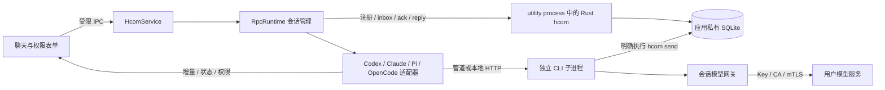

# 无终端 RPC 会话

桌面版与 `npm run web` 新建 Agent 默认使用 RPC。没有 ConPTY、TUI、shell 启动器或终端窗口，也不在 RPC 失败时自动切换为终端模式。旧 PTY 实现保留为兼容代码与历史验收材料，不是新增 Agent 的默认入口。

## 引擎与实测范围

| 引擎 | 控制接口 | 2026-10-29 验证 |
| --- | --- | --- |
| Codex | `app-server`，stdio JSON-RPC | 真实安装的 CLI，经应用网关连接本地 Responses 模拟模型，hcom 收发与最终回复通过 |
| Pi | `--mode rpc --no-session`，stdio JSONL | 真实安装的 Pi 1.0.2，本地模型往返；两个 Pi 通过真实 bash 工具执行 hcom 定向互发通过；Electron utility process 宿主通过 |
| OpenCode | `serve`，loopback HTTP + SSE | 真实安装的 OpenCode 1.18.18，本地模型往返、服务认证和 hcom 回复通过 |
| Claude Code | `--print`，双向 `stream-json` + control 协议 | 适配器的初始化、回复、权限和中断通过离线协议测试。本机 2.1.312 在初始化前报 Bun `SyntaxError: Unexpected keyword 'function'`，尚未完成真实 CLI 推理验收 |

以上实际推理测试的上游都是确定性的本地模拟服务，付费模型调用为 0。不代表已验证用户的远程模型、订阅登录或所有 CLI 版本。真实 CLI 不可用时会显示启动失败，不会伪造已就绪。

## 使用

重新构建原生核心并重启应用：

```powershell
npm run build:native
npm start
```

点击「添加 Agent」，选择引擎、Workspace、Tag 和连接方案。启动成功后可直接在群聊中 `@名字` 或 `@Tag`。同一引擎可以启动多个独立实例。

模型的 Base URL、API Key、模型 ID、CA 和 mTLS 仍在「连接与模型」中配置。选择「使用 CLI 原配置」会使用该 CLI 已有的登录和模型配置；RPC 界面不提供交互式账号登录。自定义连接继续只向 CLI 提供会话临时本地凭证，上游 Key 留在应用网关。

流式回复出现在原聊天中。点击成员旁的会话按钮或回复下的「处理确认」查看工具操作、待确认请求、排队数量及错误；可允许本次、拒绝、回答问题、中断当前任务或停止整个 Agent。关闭面板不会停止会话。

## 结构



- `lib/rpc/transport.cjs`：直接解析 exe / npm JS 入口；`shell:false`、`windowsHide:true`、stdin/stdout 管道；LF 分帧、UTF-8 解码、有界记录、请求 ID 与背压。保留原 NO_PROXY 并补充 localhost 直连，避免系统代理拦截本地网关。
- `lib/rpc/engines.cjs`：引擎协议、初始化、正文/工具事件、权限与问题、取消。Pi 等待 `agent_settled`，不把 prompt 接受或 `agent_end` 当作完整任务结束。
- `lib/rpc-runtime.cjs`：每实例串行队列；不同实例可并发。hcom 消息保留 sender、thread 和 reply ID；后端 CLI 的 session ID 单独提供给上下文观测，避免和管理器身份混淆。
- `native/hcom/src/embedded.rs` / `lib/runtime-host.cjs`：固定 RPC bus API，不调用 PTY 启动规划、TUI hooks 或终端输入方法。
- `main.cjs` / `preload.cjs`：只暴露 inspect/respond/cancel/stop 等固定会话操作。Renderer 不接触进程句柄、CLI 环境或上游凭证。

## 投递和故障语义

hcom 是持久消息来源。管理器约每 800 ms 检查其托管实例的 inbox，每实例最多预取 32 条，消费前推进持久 cursor 并记录 `rpc_delivery`，随后提交给对应引擎。启动前的历史消息不会自动发给新实例。

这是避免重复执行的投递策略，不承诺故障情况下的 exactly-once。进程崩溃、连接中断或请求超时后不自动重发、不自动重启；结果未知时停止该实例，阻止后续任务叠加。重启应用后，旧实例显示离线，不恢复或重放未确认任务。已完成的聊天回复保存在 hcom；当前流式片段仅在内存中。

普通最终回复仅显示在来源 thread，不广播给其他 Agent，避免回复相互触发。Agent 需要主动协作时，使用其获知的实例名执行 `hcom send --name NAME @TARGET --intent request --thread THREAD -- MESSAGE`；接收方从同一 inbox 接入 RPC。Workspace 限定 UI 发送范围，仍不是 OS 权限沙箱。

OpenCode 服务只绑定随机 loopback 端口，每实例随机密码；所有 HTTP 和 SSE 请求都携带认证，并限定工作目录。SSE 断开不会自动重放 prompt。权限请求等待用户操作；不传递跳过权限检查的启动选项。CLI 自己的内部网络重试策略仍由 CLI 控制。

停止时关闭该实例的输入/事件流，等待正常退出；超时仅清理所拥有的进程。在 Windows 上强制退出会针对该 PID 及其子进程执行隐藏的 taskkill，不按名称终止其他 Agent。主窗口的托盘与退出策略保持一致。

## 验证命令

```powershell
npm run check
npm test
node scripts/verify-rpc.cjs codex
node scripts/verify-rpc.cjs pi
node scripts/verify-rpc.cjs opencode
```

真实 CLI 脚本要求已安装对应引擎和已构建的 native 模块。它们使用隔离临时目录和本地模型服务器；Pi 脚本还测试真正的 Agent 间工具消息。成功证据写入忽略提交的 `artifacts/rpc-real-*.json`，失败材料保留在临时目录和对应 error 文件。

`scripts/verify-rpc.cjs` 也可以作为 Electron 入口运行，以测试真实 `utilityProcess` 宿主；启动时清除该测试子进程的 `ELECTRON_RUN_AS_NODE`。`scripts/verify-rpc-ui.cjs` 是独立隐藏 Electron UI fixture，检查流式回复、权限等待、拒绝回传、转义和无 xterm 面板，并输出截图；它不操作用户正在运行的窗口。

协议依据：[OpenAI Codex app-server](https://developers.openai.com/codex/app-server/)、[Claude Agent SDK](https://code.claude.com/docs/en/agent-sdk/streaming-vs-single-mode)、安装版本的 Pi `docs/rpc.md` / `rpc-commands.md`、[OpenCode server](https://opencode.ai/docs/server/) 及真实安装版本的 `/doc` OpenAPI。
